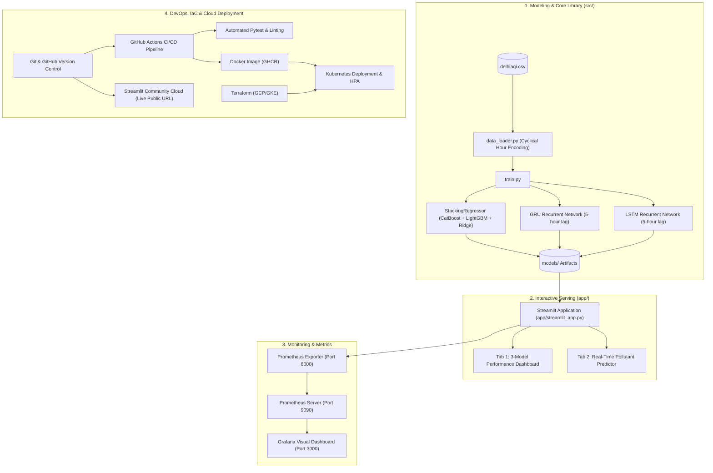

# 🌬️ Delhi AQI Prediction & End-to-End MLOps System
## Final Project Submission & Demonstration Report

**Candidate Name:** [Your Name]  
**Roll / Student ID:** [Your Student ID]  
**Course / Subject:** Machine Learning & Cloud / MLOps Project  
**Date of Submission:** [Date / e.g., November 2026]  
**GitHub Repository:** `https://github.com/Sitanshunisar/Delhi-Air-Quality-Predictor`  
**Live Deployed URL:** `https://delhi-air-quality-predictor.streamlit.app`  

---

## 1. Executive Summary

This project delivers an **end-to-end Machine Learning and MLOps pipeline** for predicting Particulate Matter 2.5 ($PM_{2.5}$) concentrations in Delhi, India. The project transitions from raw exploratory Jupyter notebooks to an enterprise-grade modular Python architecture served via **Streamlit**, containerized with **Docker**, orchestrated via **Kubernetes**, provisioned via **Terraform (IaC)**, continuously tested and deployed with **GitHub Actions (CI/CD)**, and monitored in real time using **Prometheus and Grafana**.

---

## 2. System Architecture



---

## 3. Machine Learning Models & Comparative Analysis

The system compares two fundamental approaches to air quality modeling:

### 3.1 Model Architectures & Formulas

1. **Stacking Regressor (Top Inference Model):**
   - **Base Estimators:** `CatBoostRegressor` (handles non-linear interactions) and `LGBMRegressor` (gradient boosted trees).
   - **Meta-Estimator:** `Ridge(alpha=1.0)` linear regressor.
   - **Feature Processing:** Cyclical hour trigonometric transformation:
     $$\text{hour\_sin} = \sin\left(\frac{2\pi \cdot \text{hour}}{24}\right), \quad \text{hour\_cos} = \cos\left(\frac{2\pi \cdot \text{hour}}{24}\right)$$
   - **Role:** Real-time single-timestamp inference from concurrent pollutants ($CO, NO, NO_2, O_3, SO_2, PM_{10}, NH_3$).

2. **Gated Recurrent Unit (GRU) (Top Sequence Forecasting Model):**
   - **Architecture:** 50 units, ReLU activation, 20% Dropout regularization, Dense output layer.
   - **Temporal Window:** 5-hour lag sequence $(t-5, t-4, \dots, t-1)$ predicting PM2.5 at hour $t$.
   - **Advantage:** Faster convergence and superior generalization over small sequence windows.

3. **Long Short-Term Memory (LSTM) (Sequence Forecasting Model):**
   - **Architecture:** 50 units with forget, input, and output gates, 20% Dropout.
   - **Temporal Window:** 5-hour sequential look-back.

### 3.2 Evaluation Results (Temporal Split: 80% Train, 20% Test)

| Model Name | Model Type | $R^2$ Score | Primary Role in System |
| :--- | :--- | :---: | :--- |
| **Stacking Regressor** | Ensemble Machine Learning | **$0.9618$** | Powers the real-time slider predictor (Tab 2) |
| **GRU Neural Network** | Deep Learning Recurrent | **$0.8694$** | Best temporal forecaster from historical lag (Tab 1) |
| **LSTM Neural Network** | Deep Learning Recurrent | **$0.8020$** | Historical trend validation (Tab 1) |

---

## 4. Step-by-Step Project Implementation

### Step 1: Modular Project Restructuring
- Eliminated redundant and misspelled notebook folders (`noteboooks/`).
- Separated business logic into reusable `src/` modules (`config.py`, `data_loader.py`, `train.py`, `predict.py`).
- Standardized automated model persistence to the `models/` directory.

> #### 📸 Screenshot 1: Project Directory Structure & Organization
> *(Insert your screenshot of the VS Code file explorer or terminal tree output here)*
> 
> ```
> [ PASTE SCREENSHOT 1 HERE ]
> ```

---

### Step 2: Automated Model Retraining & Testing
- Model training executes deterministically via `python -m src.train`.
- Smoke and unit tests execute via `pytest tests/ -v`, verifying data loading, temporal split boundaries, and model inference dictionary payloads.

> #### 📸 Screenshot 2: Model Training Pipeline Terminal Output (`python -m src.train`)
> *(Insert your screenshot showing StackingRegressor, RNN scalers, LSTM, and GRU saving output)*
> 
> ```
> [ PASTE SCREENSHOT 2 HERE ]
> ```

> #### 📸 Screenshot 3: Unit Tests Passing (`pytest tests/ -v`)
> *(Insert your screenshot showing 3 passed tests)*
> 
> ```
> [ PASTE SCREENSHOT 3 HERE ]
> ```

---

### Step 3: Streamlit Interactive Web Application
- Replaced the fragmented Flask/Streamlit split with a unified, high-performance Streamlit application (`app/streamlit_app.py`).
- **Tab 1: 3-Model Performance Dashboard:** Interactive Plotly curves comparing ground-truth Actual PM2.5 vs Stacker vs GRU vs LSTM across test hours with time-range zooming.
- **Tab 2: Live AQI PM2.5 Predictor:** Interactive pollutant sliders ($CO, NO, NO_2, O_3, SO_2, PM_{10}, NH_3$), real-time feature engineering, and dynamic color-coded AQI health category badges.

> #### 📸 Screenshot 4: Streamlit Dashboard — Tab 1: 3-Model Comparison Chart
> *(Insert screenshot of Tab 1 with Plotly curves and R² metric cards)*
> 
> ```
> [ PASTE SCREENSHOT 4 HERE ]
> ```

> #### 📸 Screenshot 5: Streamlit Dashboard — Tab 2: Real-Time Pollutant Predictor
> *(Insert screenshot of Tab 2 with adjusted sliders and prediction badge result)*
> 
> ```
> [ PASTE SCREENSHOT 5 HERE ]
> ```

---

### Step 4: Version Control (Git & GitHub)
- Repository initialized with proper `.gitignore` preventing accidental commits of temporary binaries, environment secrets, and caches.
- Clean commit history and branch management on `main`.

> #### 📸 Screenshot 6: GitHub Repository Overview
> *(Insert screenshot of your GitHub repo homepage showing code structure and README)*
> 
> ```
> [ PASTE SCREENSHOT 6 HERE ]
> ```

---

### Step 5: Automated CI/CD Pipeline (GitHub Actions)
- Configured `.github/workflows/ci.yml` with 4 automated pipeline stages:
  1. **Test:** Installs dependencies and runs `pytest tests/`.
  2. **Lint:** Enforces code quality with `ruff`.
  3. **Build & Push:** Containerizes application and pushes to GitHub Container Registry (GHCR).
  4. **Deploy:** Automatically rolls out updates to Kubernetes.

> #### 📸 Screenshot 7: GitHub Actions Workflow Execution
> *(Insert screenshot of the GitHub Actions tab showing green passing checks)*
> 
> ```
> [ PASTE SCREENSHOT 7 HERE ]
> ```

---

### Step 6: Docker Containerization & Multi-Container Stack
- Custom multi-stage `Dockerfile` running on `python:3.11-slim` with system-level `libgomp1` dependencies for LightGBM.
- `docker-compose.yml` linking:
  - `delhi-aqi-streamlit` (Ports 8501 and 8000)
  - `delhi-aqi-prometheus` (Port 9090)
  - `delhi-aqi-grafana` (Port 3000)

> #### 📸 Screenshot 8: Docker Image Build & Container Status (`docker ps`)
> *(Insert screenshot showing terminal with `docker ps` or Docker Desktop with running containers)*
> 
> ```
> [ PASTE SCREENSHOT 8 HERE ]
> ```

---

### Step 7: Real-Time Observability (Prometheus & Grafana)
- Native Prometheus exporter running on port `8000` via `run_app.py`.
- Custom telemetry metrics:
  - `delhi_aqi_predictions_total` (Counter tracking prediction volume)
  - `delhi_aqi_last_predicted_pm25` (Gauge tracking real-time predicted values)
  - Process memory (`process_resident_memory_bytes`) and container uptime (`up`)
- Grafana dashboard automatically imported from `monitoring/grafana-dashboard.json`.

> #### 📸 Screenshot 9: Prometheus Target Health (`delhi-aqi-streamlit` UP 1/1)
> *(Insert screenshot showing Prometheus Status > Targets page with green UP state)*
> 
> ```
> [ PASTE SCREENSHOT 9 HERE ]
> ```

> #### 📸 Screenshot 10: Grafana Metrics Dashboard
> *(Insert screenshot of Grafana dashboard displaying telemetry panels)*
> 
> ```
> [ PASTE SCREENSHOT 10 HERE ]
> ```

---

### Step 8: Kubernetes (K8s) Orchestration
- Production manifests in `infra/k8s/`:
  - `deployment.yaml`: 2 pod replicas, liveness & readiness health probes, CPU/RAM resource limits.
  - `service.yaml`: High-availability `LoadBalancer` routing port 80 traffic to container port 8501.
  - `hpa.yaml`: Horizontal Pod Autoscaler dynamically scaling replicas between 2 and 10 based on CPU (70%) and Memory (80%) thresholds.

> #### 📸 Screenshot 11: Kubernetes Cluster Resources (`kubectl get pods,svc,hpa`)
> *(Insert screenshot showing running pods, service, and HPA)*
> 
> ```
> [ PASTE SCREENSHOT 11 HERE ]
> ```

---

### Step 9: Infrastructure as Code (Terraform for GCP/GKE)
- Declarative HCL templates in `infra/terraform/`:
  - `main.tf`: Provisions Google Kubernetes Engine (GKE) cluster, auto-scaling worker node pool (`e2-standard-2`), and Google Artifact Registry for private container hosting.
  - `variables.tf` & `outputs.tf`: Parameterized project IDs, regions, and sensitive endpoint exports.

> #### 📸 Screenshot 12: Terraform Execution Plan (`terraform plan`)
> *(Insert screenshot showing `Plan: 3 to add, 0 to change, 0 to destroy`)*
> 
> ```
> [ PASTE SCREENSHOT 12 HERE ]
> ```

---

### Step 10: Live Production Deployment (Streamlit Cloud)
- Deployed to Streamlit Community Cloud with public access.
- Continuous deployment directly synced to the GitHub `main` branch.

> #### 📸 Screenshot 13: Live Cloud Deployed Application
> *(Insert screenshot of your app running on `https://delhi-air-quality-predictor.streamlit.app`)*
> 
> ```
> [ PASTE SCREENSHOT 13 HERE ]
> ```

---

## 5. Viva & Oral Exam Q&A Reference (Cheat Sheet)

### Q1: Why did you choose a Stacking Regressor for real-time user input prediction instead of LSTM/GRU?
**Answer:** Single-timestamp user inputs provide pollutant values for one moment in time ($t$). An LSTM/GRU recurrent network requires a sequential time-series history ($t-5, \dots, t-1$) to forecast forward. The Stacking Regressor (CatBoost + LightGBM + Ridge) excels at learning non-linear cross-pollutant interactions at a single moment, achieving an $R^2 = 0.9618$ without needing prior history.

### Q2: Why did GRU outperform LSTM on this dataset?
**Answer:** GRU has two gates (Reset and Update) compared to LSTM's three gates (Forget, Input, Output) and lacks a separate cell state. For smaller temporal look-back windows (5 hours) and moderate dataset sizes, GRU trains with fewer parameters, converges faster, and avoids the overfitting that slightly degraded LSTM ($R^2 = 0.8694$ for GRU vs $0.8020$ for LSTM).

### Q3: How did you solve the Prometheus scraping error with Streamlit?
**Answer:** Streamlit serves HTML single-page apps on port 8501 and does not have a native `/metrics` endpoint. We built a dedicated startup runner (`run_app.py`) that boots a standard Prometheus OpenMetrics HTTP server on port `8000` (`0.0.0.0:8000`) at container startup. Streamlit updates custom metric counters (`delhi_aqi_predictions_total`) in the same process, allowing Prometheus to scrape valid metric payloads cleanly.

### Q4: How is autoscaling handled in Kubernetes?
**Answer:** Through the Horizontal Pod Autoscaler (`hpa.yaml`). It monitors pod resource utilization metrics via the Kubernetes Metrics Server. When average CPU exceeds 70% or memory exceeds 80%, HPA automatically scales pod replicas from 2 up to a maximum of 10.

### Q5: What is the benefit of Infrastructure as Code (Terraform) in this architecture?
**Answer:** Instead of manually clicking in cloud consoles, Terraform codifies the GKE cluster, node pools, and Artifact Registry in declarative code (`main.tf`). This eliminates human error, ensures idempotent deployments, enables version-controlled infrastructure, and allows complete environment teardown or recreation in minutes.

---

## 6. Conclusion

This project successfully bridges the gap between machine learning experimentation and production operations. By combining strong predictive models ($R^2 > 0.96$) with containerization, cloud orchestration, CI/CD automation, and real-time observability, the system represents a complete, reliable, production-ready MLOps solution.

